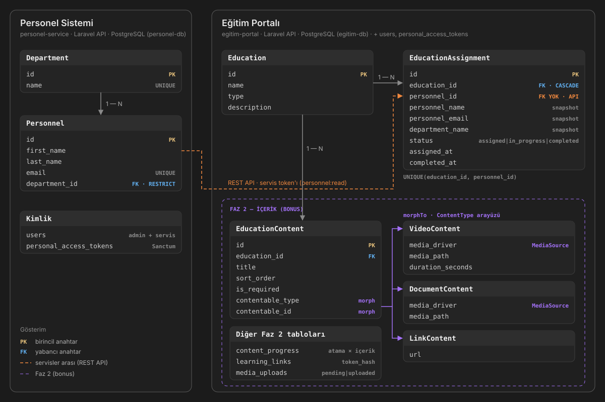

# 02 — Mimari

> Gereksinimler: [01-gereksinimler.md](01-gereksinimler.md). Buradaki kararlar sabittir; değiştirmeden önce sor.



## 1. Genel Bakış
```
Tarayıcı ──► Next.js :3000 (BFF, DB yok)
                │ admin token          │ admin token
                ▼                      ▼
     Personel Sistemi        ◄──  Eğitim Portalı :8002
     Laravel API         servis    Laravel API · medya: local disk
          │              token'ı        │
     PostgreSQL (personel-db)      PostgreSQL (egitim-db)
```
- **Tarayıcı sadece Next ile konuşur.** Backend adresleri ve token'lar tarayıcıya inmez.
  - **İstisna (Faz 2):** Medya oynatma ve dosya yükleme. Bu ikisinde tarayıcı Eğitim Portalı'na kısa süreli imzalı URL'lerle doğrudan bağlanır.
- **Next veri saklamaz, iş kuralı içermez.** Kuralların hepsi backend'dedir.
- **Personel verisi:** Eğitim Portalı bu veriyi değiştirmez. Atama anındaki bilgiyi kendi tablosunda bir kopya (snapshot) olarak saklar.
- **İsimlendirme:**
  - Diyagramdaki "Personel" kodda `Personnel` modeli ve `personnel` tablosudur. "Education" tablosu `educations`'tır. İkisi de sayılamayan isim olduğu için `$table` açıkça yazılır.
  - "Name/Surname" alanları `first_name`/`last_name` olarak yazılır.
  - Panelin URL'leri Türkçedir (`/personel`, `/egitimler`).

## 2. Kimlik Doğrulama

| Token | Kimin elinde | Yetki (ability) | Süre |
|---|---|---|---|
| Admin (Personel Sistemi) | Next, `ps_session` cookie'si | `personnel:read`, `personnel:write` | 8 saat |
| Admin (Eğitim Portalı) | Next, `ep_session` cookie'si | `education:manage` | 8 saat |
| Servis | Eğitim Portalı env | `personnel:read` | Süresiz |
| Öğrenme (F2) | Link içinde | Tek bir atama | 30 gün, iptal edilebilir |

- İlk üç token Sanctum ile üretilir. Süre token bazında verilir (`createToken(..., $expiresAt)`), global `expiration` ayarı kullanılmaz.
- **Giriş:** Next, bir Server Action içinde iki backend'in `POST /api/auth/login` endpoint'ini paralel çağırır.
  - İkisi de başarılıysa iki cookie yazılır.
  - Biri başarısızsa diğerinin token'ı da iptal edilir ve giriş başarısız sayılır.
- **Cookie ayarları:** `httpOnly`, `sameSite=lax`, `path=/`. `secure` bayrağı `COOKIE_SECURE` env değişkeniyle açılır. Düz HTTP'de (localhost, yerel ağdaki Pi) `false` kalmalıdır, aksi halde tarayıcı cookie'yi kaydetmez ve giriş yapılamaz.
- **Sayfa koruması:** `middleware.ts` sadece cookie'nin varlığına bakar. `/login` ve `/ogren/*` yolları muaftır.
- **Backend 401 dönerse:** kullanıcı `/logout?expired=1` adresine yönlendirilir. Buradaki Route Handler cookie'leri temizleyip login'e yönlendirir.
- **Login rate limit:** dakikada 5 deneme.
- Her backend kendi `users` tablosunu tutar.

## 3. API Sözleşmesi

**Personel Sistemi**
```
POST /api/auth/login {email,password} → {token, expires_at, user} · POST /api/auth/logout · GET /api/auth/me
/api/admin/personnel      GET(?search,department_id,page) POST · GET PUT DELETE /{id}    personnel:write
/api/admin/departments    GET POST · PUT DELETE /{id}  (personeli varsa DELETE → 409)
/api/service/personnel    GET(?department_id) · GET /{id}         personnel:read, throttle:60,1
/api/service/departments  GET
```

**Eğitim Portalı, Faz 1** (`education:manage`)
```
/api/auth/login | logout | me
/api/educations                    GET (ilerleme sayılarıyla) POST · GET PUT DELETE /{id}
/api/educations/{id}/assignments   GET · POST {personnel_ids[]} → {created, already_assigned, not_found} | 503
/api/assignments/{id}              PATCH {status} · DELETE
/api/personnel                     GET (Personel Sistemi verisi + kişi başı total/completed)
/api/personnel/{id}/assignments    GET
/api/departments                   GET (Personel Sistemi'nden)
```

**Eğitim Portalı, Faz 2**
```
POST  /api/educations/{id}/uploads      → {upload_id, upload_url, method, headers}
POST  /api/educations/{id}/contents     {type, title, is_required, upload_id | url}
PATCH /api/educations/{id}/contents/order · DELETE /api/contents/{id}
POST  /api/assignments/{id}/learning-link → {token, expires_at} · DELETE (iptal)
PUT   /uploads/{id}?signature           tarayıcıdan doğrudan yükleme (CORS: FRONTEND_URL)
GET   /api/learn                        header X-Learning-Token → içerikler + ilerleme + playback_url
POST  /api/learn/contents/{id}/progress {position, duration}
GET   /media/{path}?signature           Range destekli stream
```

**Ortak format**
```
Personnel     = {id, first_name, last_name, full_name, email, department:{id,name}}
Sayfalı yanıt = {data, meta:{current_page, last_page, total}}
Personel verisi içeren EP yanıtları: meta.personnel_source = "live" | "stale" | "unavailable"
Hatalar: {message} · 422 → {message, errors:{alan:[...]}}
```

## 4. Veri Modeli
```
PS: departments(id, name UNIQUE)
    personnel(id, first_name, last_name, email UNIQUE, department_id FK RESTRICT)

EP: educations(id, name, type, description)
    education_assignments(id, education_id FK CASCADE, personnel_id INDEX (FK YOK),
        personnel_name, personnel_email, department_name,      ← snapshot
        status, assigned_at, completed_at, UNIQUE(education_id, personnel_id))
 F2 education_contents(id, education_id, title, sort_order, is_required, contentable_type, contentable_id)
      video_contents(id, media_driver, media_path, mime_type, size_bytes, duration_seconds)
      document_contents(id, media_driver, media_path, mime_type, size_bytes)
      link_contents(id, url)
    content_progress(id, assignment_id, content_id, max_position_seconds, last_position_seconds,
        last_heartbeat_at, completed_at, UNIQUE(assignment_id, content_id))
    media_uploads(id UUID, media_driver, path, status pending|uploaded, expires_at)
    learning_links(id, assignment_id, token_hash UNIQUE, expires_at, revoked_at)

İki uygulamada da: users, personal_access_tokens (Sanctum)
```
- `status` veritabanında `string` bir kolon, kodda PHP enum'ıdır: `assigned`, `in_progress`, `completed`.
- Durum değişikliği yalnızca `EducationAssignment::changeStatus()` ile yapılır (BR-5).
- Veritabanı PostgreSQL'dir, testler SQLite'ta da çalışır (03 §4). Bu yüzden veritabanına özgü SQL ve native enum kullanılmaz.

## 5. Polimorfizm
1. **Veri:** `education_contents` tablosu `morphTo` ile türe özel tablolara bağlanır. `enforceMorphMap` sayesinde veritabanında sınıf adı yerine `video` gibi kısa bir takma ad saklanır.
2. **Davranış:** Her içerik türü kendi tamamlanma kuralını bilir. Servislerde `instanceof` ile tür kontrolü yapılmaz. Frontend'de de `kind` değerine göre bileşen seçen bir harita kullanılır.
   ```php
   interface ContentType {
       public function kind(): string;                           // video | document | link
       public function isCompletedBy(ContentProgress $p): bool;  // BR-6
   }
   ```
3. **Altyapı: `MediaSource` (strateji deseni).**
   ```php
   interface MediaSource {
       public function createUploadTarget(string $path, string $mime, int $maxBytes, DateTimeInterface $exp): UploadTarget; // {url, method, headers}
       public function playbackUrl(string $path, DateTimeInterface $exp): string;
       public function exists(string $path): bool;
       public function delete(string $path): void;
   }
   ```
   - Şimdilik sadece `local` driver yazılır. `s3` ve `youtube` sadece tasarlanır.
   - Hangi depolamanın kullanıldığı her kayıtta ayrı tutulur (`media_driver` kolonu), doğru driver'ı `MediaManager` (`Illuminate\Support\Manager`) seçer.
   - Buluta geçişte frontend değişmez, çünkü tarayıcı her zaman backend'in verdiği `{url, method, headers}` hedefine yükleme yapar.
   - **Neden doğrudan `Storage::disk()` değil?** Laravel'in Filesystem'i yükleme hedefi ve oynatma URL'i üretmeyi, ayrıca YouTube gibi dosyası olmayan kaynakları çözmez.

## 6. Faz 2 Akışları
- **Öğrenme linki:**
  - Rastgele bir token üretilir, veritabanında sadece sha256 hash'i saklanır. Link: `{PUBLIC_FRONTEND_URL}/ogren/{token}`.
  - Next token'ı `X-Learning-Token` header'ıyla iletir.
  - Geçersiz, süresi dolmuş ya da iptal edilmiş token'ların hepsine aynı yanıt (404) verilir.
  - Laravel'in imzalı URL'i kullanılmaz, çünkü imza Laravel'in kendi adresine bağlıdır ve iptal edilemez.
- **İzleme:**
  - Oynatıcı her 10 saniyede bir `{position, duration}` bildirir.
  - Sunucu en fazla `(geçen süre × 2) + 5 sn` kadar ilerlemeyi kabul eder (BR-8).
  - Ardından `isCompletedBy` kontrol edilir ve durum sadece ileri yönde güncellenir (BR-7).
- **Yükleme:**
  1. Panel, Eğitim Portalı'ndan bir yükleme hedefi ister.
  2. Tarayıcı dosyayı bu hedefe XHR ile, ilerleme göstererek yükler.
  3. Panel `upload_id` ile içeriği oluşturur.
  - Hiçbir içeriğe bağlanmayan dosyaları `media:prune` komutu 24 saat sonra siler.

## 7. Dayanıklılık ve Hatalar
- **Eğitim Portalı → Personel Sistemi:**
  - Timeout 5 sn, liste cache'i 5 dk.
  - Personel Sistemi kapalıysa son başarılı yanıt kullanılır ve `personnel_source` alanı `stale` olur.
  - Atama yapılırken cache kullanılmaz (BR-3).
- **Next → backend'ler:** `cache: 'no-store'` kullanılır. Mutation'lar Server Action ile yapılır, ardından `revalidatePath` çağrılır.
- **Panelde hata eşleme:**

| Yanıt | Panelde |
|---|---|
| 401 | `/logout` |
| 403 | "Yetkiniz yok" |
| 404 | `notFound()` |
| 409, 503 | toast |
| 422 | ilgili form alanı |
| Ağ hatası | `error.tsx` |

## 8. Kod Düzeni
- **Laravel:**
  - Controller'lar ince tutulur. Validation için FormRequest, JSON yanıtlar için API Resource kullanılır.
  - İş kuralları model ya da servis sınıflarında yaşar.
  - Dış sistemlere yalnızca `PersonnelApiClient` ve `MediaSource` üzerinden erişilir.
  - Kullanıcı mesajları Türkçe, kod isimleri İngilizcedir.
- **Next:**
  - App Router, TypeScript, Tailwind, shadcn/ui ve Zod kullanılır.
  - Backend çağrıları sadece `lib/api/*` içinde yapılır ve bu dosyalar `import 'server-only'` ile başlar.
  - Mutation'lar `actions.ts` dosyalarında yazılır. `lib/api/types.ts` dosyası §3'ün TypeScript karşılığıdır.
  - Env değerleri çalışma zamanında `process.env` ile okunur. `NEXT_PUBLIC_` kullanılmaz.

## 9. Kararlar
| # | Karar | Neden |
|---|---|---|
| 1 | Servisler arası senkron REST + cache | Şartname "API üzerinden" diyor. Event/kuyruk bu ölçekte gereksiz |
| 2 | Sanctum, yetkiyle sınırlı token türleri | Hash'li saklama, iptal edilebilirlik, en az yetki |
| 3 | Snapshot kolonları, `personnel_id`'de FK yok | Personel başka bir veritabanında, geçmiş kaybolmaz |
| 4 | Polimorfik içerik + `ContentType` | Boş kolon yok, yeni tür eklemek kolay |
| 5 | `MediaSource` + doğrudan yükleme | Buluta geçişte frontend dahil kod değişmez |
| 6 | Öğrenme linki için token | Next arkasında çalışır, iptal edilebilir |
| 7 | Hibrit tamamlanma, otomatik geçiş sadece ileri | Otomasyon ile admin kontrolü çatışmaz |
| 8 | Tek Next uygulaması, BFF | Token'lar tarayıcıya inmez, CORS gerekmez |
| 9 | Her backend'in kendi admin kullanıcısı | Ortak kullanıcı veritabanı yok |
| 10 | Her backend için ayrı PostgreSQL container'ı | "Ayrı veritabanı" kuralı fiziksel olarak da sağlanır |
| 11 | Tek compose, her ortamda yerinde build | Docker sayesinde aynı adımlar PC'de ve Pi'de çalışır, registry gerekmez |
